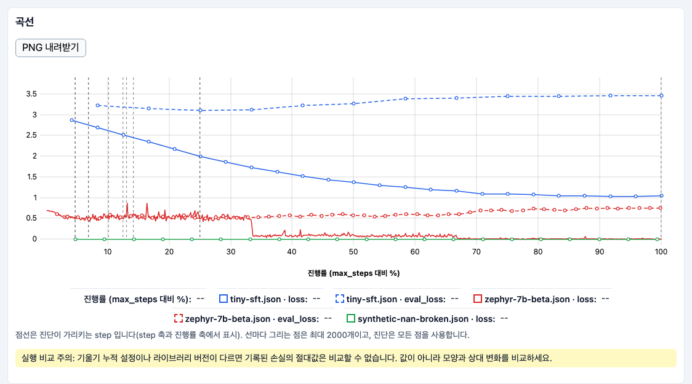
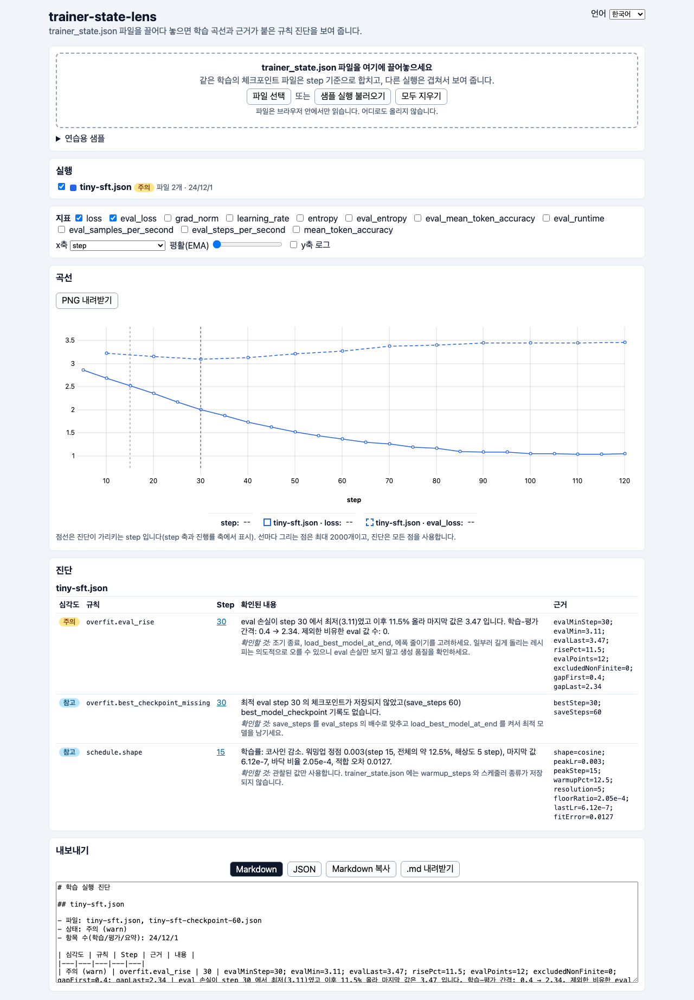
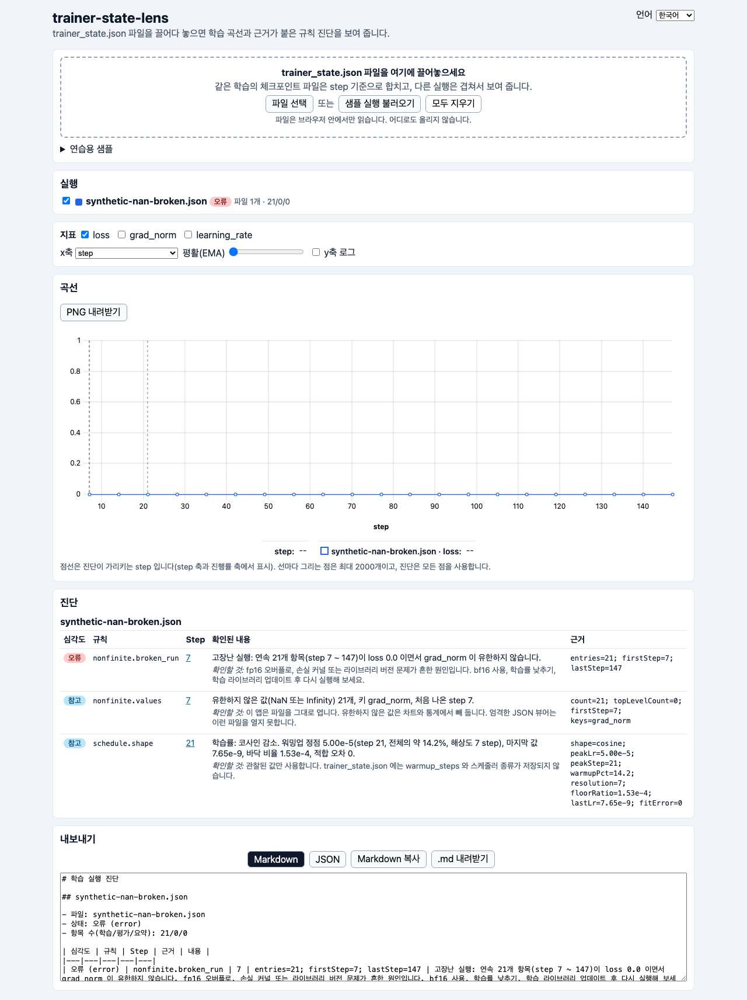
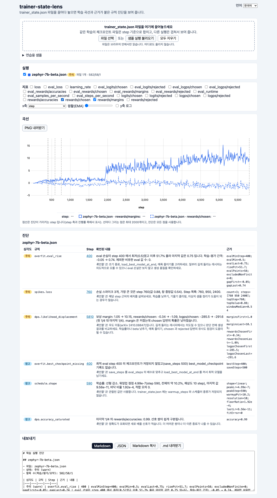
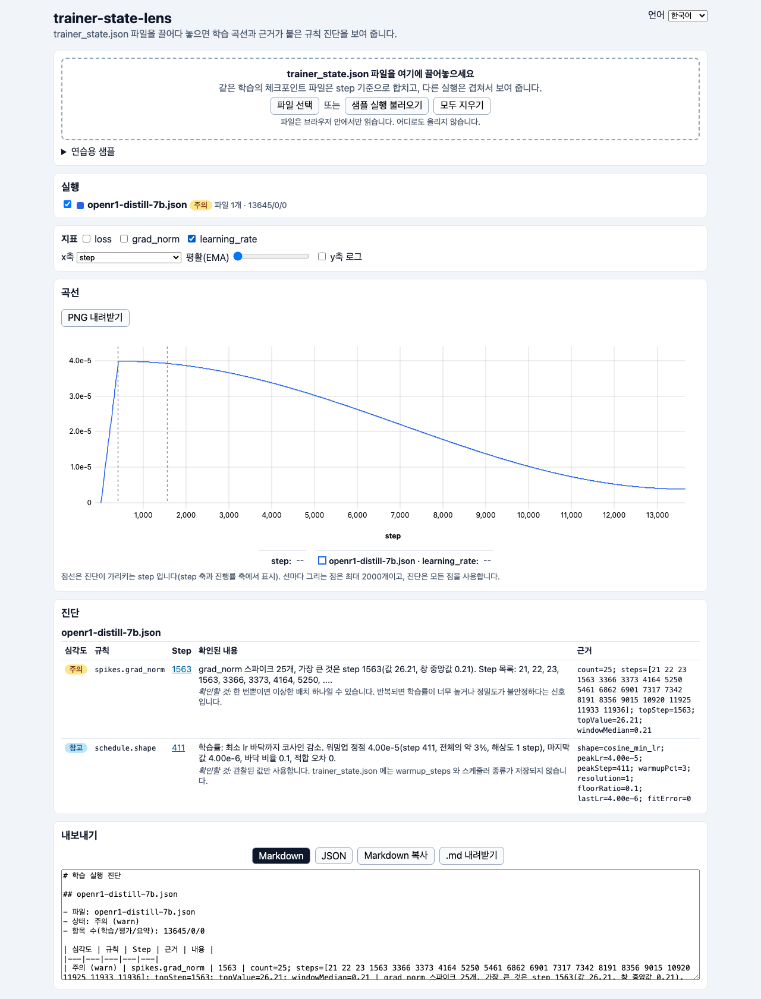
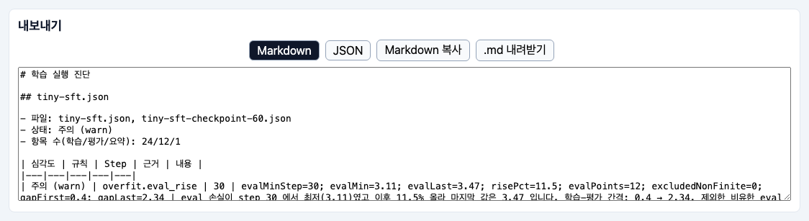
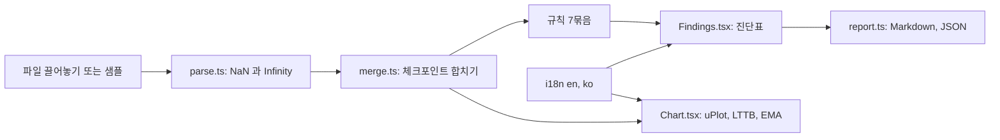

# trainer-state-lens

[English](README.md) | **한국어**

Hugging Face `trainer_state.json` 파일을 브라우저에 끌어다 놓으면 학습 곡선을 겹쳐 보여 주고, 과적합 시작점·NaN(숫자가 아닌 값)이나 고장난 실행·손실과 grad_norm 스파이크·발산·학습률 스케줄 모양·DPO 우도 이동(likelihood displacement)·GRPO 정체를 근거 수치와 함께 규칙으로 진단합니다. 학습이 끝난 뒤에 쓰고, 미리 로깅을 켜 둘 필요가 없으며, 파일은 브라우저 밖으로 나가지 않습니다.


***샘플 실행 불러오기**를 누른 뒤의 차트: 연습 파일 4개를 불러오고, `tiny-sft` 파일 두 개는 한 실행으로 합쳐지므로 실행 3개가 그려집니다. 길이가 10배 넘게 달라서 x축은 진행률(`max_steps` 의 %)로 열립니다. 진단표는 차트 아래에 있습니다(시나리오 참고).*

## 이런 분께

- `Trainer`나 TRL(SFT·DPO·GRPO)로 학습했는데 W&B·TensorBoard 기록은 없고 `trainer_state.json` 만 남은 분
- Hub에서 받은 체크포인트의 학습이 어떻게 흘렀는지 보고 싶은 분
- 실행 하나를 PR이나 모델 카드에 붙일 Markdown 요약으로 만들고 싶은 분

## 설치

Node.js `^22.12.0`, `^24.0.0`, `>=26.0.0` 이 필요합니다(테스트 도구 vitest 5.1.0 의 요구이며 Node 20 에서는 `npm test` 가 돌지 않습니다). git 도 필요합니다.

```bash
# nvm(https://github.com/nvm-sh/nvm)으로 Node 설치(다른 Node 관리 도구도 됩니다) 후 앱 설치
nvm install 24
git clone https://github.com/LeeGyeongPil/trainer-state-lens.git
cd trainer-state-lens
npm install
```

최소 리눅스 이미지에서는 먼저 `git`, `curl`, `ca-certificates` 를 설치하세요(예: `apt-get install -y git curl ca-certificates`). 앱 자체는 정적 파일입니다. `npm run build` 가 `dist/` 를 만들고, 아무 정적 호스팅에서나 서비스할 수 있습니다. 저장소에는 GitHub Pages 워크플로(`.github/workflows/pages.yml`)가 들어 있고, 기본은 꺼져 있습니다. `main` 에 push 할 때마다 배포하려면 저장소 설정에서 Pages 소스를 "GitHub Actions" 로 켜고 Actions 저장소 변수 `PAGES_ENABLED=true` 를 추가하세요. Actions 탭에서 손으로 실행할 수도 있습니다.

## 빠르게 시작하기

```bash
npm run dev
```

출력된 주소(기본 `http://localhost:5173`)를 열고 **연습용 샘플**(Practice samples)을 펼쳐 **샘플 실행 불러오기**(Load sample runs)를 누르세요. 키·GPU·네트워크가 필요 없습니다.

자기 파일을 쓰려면 `trainer_state.json` 을 끌어다 놓으세요. 학습 출력 폴더와 모든 `checkpoint-*` 폴더 안에 있습니다.

## 사용법

| 조작 | 하는 일 |
|---|---|
| 끌어놓기 영역 / **파일 선택** | 브라우저 안에서 파일을 읽습니다. 같은 학습의 체크포인트 파일은 step 기준으로 합치고, 다른 실행은 겹쳐 보여 줍니다. |
| **샘플 실행 불러오기**, **연습용 샘플** 목록 | 내장 연습 파일을 추가합니다(아래 참고). |
| 실행 목록 | 실행마다 색·이름·상태·파일 수. 체크박스로 차트에서 숨깁니다. |
| 지표 체크박스 | 불러온 파일에 있는 키만 나옵니다(`loss`, `eval_loss`, `grad_norm`, `learning_rate`, `rewards/margins` 등). |
| X축 | `step`, `epoch`, 파일에 `num_tokens` 가 있으면 토큰 수, 또는 `progress`(step 을 `max_steps` 의 %로). 보이는 실행의 길이가 10배 넘게 다르면 `progress` 로 열리고, 메뉴에서 직접 고르면 그 선택이 우선합니다. |
| 축 | 최댓값이 0 보다 크고 0.01 보다 작은 지표(예: `learning_rate`)는 `loss` 처럼 큰 값 지표와 함께 보일 때만 오른쪽 두 번째 y축에 지수 표기(예: `4.0e-5`)로 그려집니다. 이때 양쪽 축에 지표 이름이 붙습니다(`왼쪽 축: loss`, `오른쪽 축: learning_rate`). 값이 전부 0 인 지표는 오른쪽 축을 열지 않습니다. 축 폭은 가장 긴 눈금에 맞춰집니다. |
| 평활(EMA) | 지수 이동 평균 슬라이더. 진단은 항상 원본 값을 씁니다. |
| 로그 y축 | 로그 스케일. |
| 진단표 | 심각도·규칙·step·근거 수치·무엇이 보이나·무엇을 확인하나. step 링크를 누르면 그 step 으로 확대하고, step 축에서는 점선이 진단된 step 을 표시합니다. |
| **PNG 내려받기**(차트 패널) | 지금 화면의 차트(숨긴 실행, 지표, 평활, 로그 y축, 확대 범위, 점선 표시 그대로)를 `training-curves.png` 로 저장합니다. 숨긴 선은 그림에서도 빠집니다. 실행·지표 범례가 축 이름과 함께 그림에 들어갑니다. 파일은 브라우저 안에서 만들어지고 어디로도 전송되지 않습니다. |
| 내보내기 | Markdown 또는 JSON, 복사 또는 다운로드. |
| 언어 | 오른쪽 위 English / 한국어 메뉴. |

차트는 줄마다 최대 2000점만 그리고(LTTB 다운샘플), 규칙은 모든 점을 읽습니다. 실행을 겹쳐 보면 안내가 뜹니다: 기울기 누적 설정이나 라이브러리 버전이 다르면 기록된 손실을 그대로 비교할 수 없으니 절댓값이 아니라 모양을 비교하세요.

### 시나리오 1: 내 SFT가 과적합일까?

`tiny-sft` 와 `tiny-sft-checkpoint-60`(같은 실행의 체크포인트 파일과 최종 파일)을 엽니다. 하나의 실행(37항목)으로 합쳐집니다.


*eval 손실은 step 30 에서 가장 낮고 이후 11.5% 오르며, train-eval 간격은 0.40 에서 2.34 로 벌어집니다. 최적 step 은 체크포인트로 저장되지 않았습니다.*

`warn` 행은 과적합이 시작되는 곳을, `info` 행은 최적 step 이 저장되지 않았음(`save_steps` 60, 최적 step 30)을 알려 줍니다. 권장 조치는 조기 종료, `load_best_model_at_end`, `save_steps` 를 `eval_steps` 의 배수로 맞추기입니다.

### 시나리오 2: 엄격한 JSON 뷰어가 거부하는 파일

fp16 오버플로 뒤의 `trainer_state.json` 에는 JSON 규격이 아닌 맨 `NaN` 이 들어 있을 수 있습니다. `synthetic-nan-broken` 을 불러 보세요.


*파일이 열립니다. `error` 행은 loss 0.0 이고 grad_norm 이 비유한(NaN 등)인 항목이 21개 연속(step 7~147)이라고 알려 주고, `info` 행은 NaN 값의 위치를 적습니다.*

### 시나리오 3: DPO에서 보상 마진은 커지는데 chosen 답변은 덜 나올 때

`zephyr-7b-beta` 를 열고 지표를 `rewards/margins` 와 `rewards/chosen` 으로 바꿉니다.


*마진은 커지는데 `rewards/chosen` 은 내려갑니다. 규칙이 처음·마지막 4분의 1 평균과 함께 우도 이동(arXiv 2410.08847)을 보고합니다.*

### 시나리오 4: 이 학습률 스케줄은 정상일까?

`openr1-distill-7b`(13,645점)를 열고 `learning_rate` 를 표시합니다.


*정점의 10%에서 멈추는 코사인 감소는 이상하다고 보지 않고 `cosine_min_lr` 로 인식합니다. `spikes.grad_norm` 진단은 따로 보고됩니다(스파이크 25개, 가장 큰 것은 step 1563).*

### 시나리오 5: 결과를 다른 곳에 붙이기


*내보내기 패널은 **Markdown 복사**가 클립보드에 넣는 Markdown 또는 JSON 텍스트를 그대로 보여 줍니다.*

Markdown 은 실행마다 표 하나입니다. 발췌(스냅숏 테스트 `tests/__snapshots__/report.test.ts.snap` 에서, 영어 내보내기):

```markdown
## tiny-sft.json

- Files: tiny-sft-checkpoint-60.json, tiny-sft.json
- Status: warn
- Entries (train/eval/summary): 24/12/1

| Severity | Rule | Step | Evidence | Message |
|---|---|---|---|---|
| warn | overfit.eval_rise | 30 | evalMinStep=30; evalMin=3.11; evalLast=3.47; risePct=11.5; ... | Eval loss was lowest at step 30 (3.11) and rose 11.5% to 3.47. ... |
```

화면 언어를 한국어로 두면 내보내는 Markdown 도 한국어이고, 심각도 칸은 화면 배지와 같은 말 뒤에 기계용 값을 괄호로 붙입니다(같은 스냅숏, 한국어 내보내기 발췌):

```markdown
- 상태: 주의 (warn)

| 심각도 | 규칙 | Step | 근거 | 내용 |
|---|---|---|---|---|
| 주의 (warn) | overfit.eval_rise | 30 | evalMinStep=30; evalMin=3.11; evalLast=3.47; risePct=11.5; ... | eval 손실이 step 30 에서 최저(3.11)였고 이후 11.5% 올라 마지막 값은 3.47 입니다. ... |
| 참고 (info) | overfit.best_checkpoint_missing | 30 | bestStep=30; saveSteps=60 | 최적 eval step 30 의 체크포인트가 저장되지 않았고(save_steps 60) ... |
```

영어 내보내기와 JSON 은 그대로입니다. JSON 은 고정 스키마 `{ version, lang, runs: [{ name, status, files, entries: { train, eval, summary }, findings: [{ rule, severity, step, evidence, message, action }] }] }` 이고, 같은 입력은 항상 같은 출력을 냅니다.

## 진단 결과 읽는 법

실행마다 진단표가 하나씩 나옵니다. 이렇게 읽으세요.

- **심각도**: `error` 는 실행이 고장났을 가능성, `warn` 은 "가서 확인하라", `info` 는 알아둘 사실, `ok` 는 규칙이 봤고 문제가 없다는 뜻입니다. `warn` 은 실패가 아닙니다. 길게 돌리는 레시피는 일부러 이럴 수도 있습니다(시나리오 3 의 zephyr-7b-beta 는 우도 이동으로 `warn` 이 나오므로 판단 전에 생성 결과를 비교하세요). 실행의 배지는 가장 심각한 결과를 따릅니다.
- **Step**: 링크입니다. 누르면 차트가 그 step 으로 확대되고, `step`·`progress` 축에서는 진단된 step 에 세로 점선이 표시됩니다.
- **근거(Evidence)**: 규칙이 쓴 수치입니다(예: `evalMinStep=30; risePct=11.5`). Markdown·JSON 내보내기에도 같은 수치가 있어 직접 검산할 수 있습니다.
- **무엇이 보이나 / 무엇을 확인하나**: 패턴을 풀어 쓴 문장과 다음에 볼 곳입니다. 규칙은 기록만 설명할 뿐 사용자의 의도는 모릅니다.

## 무엇을 검사하나

필요한 키가 파일에 있을 때만 규칙이 켜집니다(예: 2023년 파일에는 `grad_norm` 이 없습니다). 심각도 뜻은 위에 있습니다.

| 규칙 | 필요한 키 | 보고 내용 | 기본 임계값 |
|---|---|---|---|
| `nonfinite.broken_run` | `loss`, `grad_norm` | loss 0.0 이고 grad_norm 이 비유한인 항목이 연속이면 `error` | 연속 3개 이상 |
| `nonfinite.all_loss` | `loss` | 기록된 학습 손실이 전부 NaN / Infinity 면 `error`(첫 항목부터 고장) | 전체 항목 |
| `nonfinite.values` | 모두 | `log_history` 안의 NaN / Infinity 값의 키와 첫 step 을 `warn` 으로. 최상위 값(예: `best_metric`)뿐이거나 이미 `broken_run` / `all_loss` 오류가 있으면 `info` | 1개 이상 |
| `run.empty` | 모두 | 학습 항목이 하나도 없어 진단할 것이 없으면 `info` | 해당 없음 |
| `overfit.eval_rise` | `eval_loss` | eval 손실이 최저점 위로 오르면 `warn`(비유한 값은 빼고 개수를 적음), 아니면 `ok` | 5% 이상 상승 |
| `overfit.best_checkpoint_missing` | `eval_loss`, `save_steps` | 최적 eval step 의 체크포인트가 저장되지 않았으면 `info` | 해당 없음 |
| `spikes.loss`, `spikes.grad_norm` | `loss`, `grad_norm` | 고립된 급등을 `warn`(이동 중앙값 + MAD, 상대·절대 하한) | 창 20점, 6 MAD, 중앙값 대비 50%, 시작 수준의 15% |
| `spikes.divergence` | `loss` | 손실이 비유한으로 끝나거나 최적 수준보다 훨씬 위로 되돌아가면 `error` | 최적 수준의 2배, 시작 손실의 25% |
| `schedule.shape` | `learning_rate` | 모양(상수·선형·코사인, 최소 lr 바닥 유무), 워밍업 정점, 적합 오차를 `info` 로. 불규칙하면 `warn` | 적합 오차 0.08 초과 |
| `run.incomplete` | `max_steps` | `global_step` 이 `max_steps` 보다 작으면 `info` | 해당 없음 |
| `dpo.likelihood_displacement` | `rewards/margins`, `rewards/chosen`, `logps/chosen` | 마진은 커지는데 chosen 보상·로그 확률이 내려가면 `warn` | 처음 대 마지막 4분의 1 평균 |
| `dpo.accuracy_saturated` | `rewards/accuracies` | 정확도가 포화면 `info` | 0.95 |
| `grpo.zero_std_groups`, `grpo.reward_flat`, `grpo.kl_high`, `grpo.entropy_collapse`, `grpo.truncation` | GRPO 키 | 보상이 모두 같은 그룹, 평탄한 보상, 큰 KL, 엔트로피 붕괴, 길이 한계에 닿는 완성문을 `warn` 또는 `info` 로 | zero-std 비율 0.5, 보상 증가 0.02, KL 0.1 |

임계값은 모두 `src/core/rules/options.ts` 의 `DEFAULT_THRESHOLDS` 필드이고, `diagnose(run, { thresholds })` 로 호출마다 바꿀 수 있습니다. 아직 설정 화면은 없습니다(로드맵 참고).

관찰한 값만 씁니다. `trainer_state.json` 에는 `warmup_steps` 나 스케줄러 종류가 저장되지 않으므로, 스케줄 규칙은 보이는 모양을 설명합니다.

## 연습용 샘플

내장된 오프라인 연습 파일입니다. **실제 파일과 합성 파일이며, 실시간 학습이 아닙니다.** 앱에서 파일마다 출처 라벨이 붙습니다.

| 라벨 | 파일 | 보여 주는 것 |
|---|---|---|
| 직접 실행(MIT) | `tiny-sft`, `tiny-sft-checkpoint-60`, `tiny-dpo`, `tiny-grpo` | CPU로 학습한 2층 GPT-2 아주 작은 모델. SFT 는 일부러 16문장을 외우게 했습니다 |
| Hub 파일 | `zephyr-7b-beta`(MIT), `mistral-7b-sft-beta`(MIT), `smollm2-1.7b-instruct`(Apache-2.0), `openr1-distill-7b`(Apache-2.0) | 실제 실행: 우도 이동, 406 step 중 272 에서 멈춘 실행, 정상 DPO 기준, 최소 lr 바닥 |
| 합성 | `synthetic-nan-broken`, `-eval-nan`, `-infinity-best`, `-flat-jitter`, `-diverge`, `-grpo-stall` | 공개 파일에서 본 고장 모양. `tools/make-samples/make_synthetic.py` 로 생성 |

파일별 출처와 라이선스는 [samples/SOURCES.md](samples/SOURCES.md) 에 있습니다. 실제 모드는 자기 파일을 넣는 것입니다. 직접 실행 샘플을 다시 만드는 것은 선택입니다(`tools/make-samples/README.md` 참고, torch·transformers·trl 설치에 시간이 걸리고 속도는 CPU에 따라 다릅니다).

## 이 도구가 다루는 함정

- 문자열 밖의 맨 `NaN`, `Infinity`, `-Infinity`(최상위 `best_metric` 포함)를 복원하고, 문자열 안의 `"NaN"` 은 글자 그대로 둡니다.
- `eval_loss` 의 NaN 이 "최솟값"이 되지 않도록 비유한 값을 빼고 개수를 적습니다.
- `loss 0.0` 과 `grad_norm NaN` 이 함께면 수렴이 아니라 고장난 실행으로 봅니다.
- 수렴한 손실의 아주 작은 흔들림은 스파이크로 보지 않습니다(상대·절대 하한).
- 바닥에서 멈추는 코사인 스케줄을 이상한 모양으로 보지 않습니다.
- 끝나지 않은 실행(체크포인트 사본)은 완료로 읽지 않고 표시합니다.
- 최적 eval step 이 체크포인트로 없으면 알려 줍니다.
- 기록된 손실은 기울기 누적과 라이브러리 버전에 따라 다릅니다([Hugging Face 블로그](https://huggingface.co/blog/gradient_accumulation), [transformers#40564](https://github.com/huggingface/transformers/issues/40564)). 그래서 실행끼리는 모양으로 비교하고, 규칙은 한 실행 안의 상대 변화만 씁니다.

## 언어

화면, 진단 문구, 내보내는 Markdown 이 영어와 한국어를 지원합니다. **언어** 메뉴에서 고르면 `localStorage`(키 `trainer-state-lens.lang`)에 저장됩니다. 브라우저 언어는 첫 방문에만 쓰입니다(`ko*` 면 한국어, 그 밖은 영어). 주소의 `?lang=ko` 또는 `?lang=en` 은 그 방문에서 우선하며 저장되지 않습니다.

## 개인정보

앱은 브라우저의 `File` API 로 파일을 읽고 서버가 없습니다. `src/` 에 `fetch`, `XMLHttpRequest`, `WebSocket`, `sendBeacon`, `EventSource` 가 없는지 테스트가 검사하므로 아무것도 업로드되지 않습니다.

## 동작 원리



1. 파서는 텍스트를 한 번 훑어 문자열 밖의 비유한 토큰을 표식으로 바꿨다가 숫자로 복원하고, `log_history` 를 학습·평가·요약 항목으로 나눕니다.
2. 합치기는 설정이 같고 공유 step 의 값이 같은 파일을 한 실행으로 보고 가장 긴 기록을 남깁니다. 그 밖의 파일은 별도 실행입니다.
3. 규칙 엔진은 `src/core` 의 순수 TypeScript(DOM·React 없음)라서 나중에 명령줄 도구가 그대로 재사용할 수 있습니다.
4. 차트(캔버스의 uPlot)와 진단표는 같은 합쳐진 실행을 읽습니다.
5. 내보내기는 진단을 선택한 언어의 Markdown 또는 JSON 으로 씁니다.

## 언제 쓰나

학습이 끝난 뒤 이미 가진 파일을 위한 도구입니다. 학습 중에 로그를 모으지 않고, 실험 추적 도구를 대체하지 않습니다.

| 상황 | 쓸 것 |
|---|---|
| 끝난 `trainer_state.json` 으로 곡선과 첫 진단을 오프라인으로 보고 싶다 | 이 앱 |
| 학습하는 동안 기록하고 실행을 비교하고 싶다 | [Trackio](https://github.com/gradio-app/trackio), [Weights & Biases](https://github.com/wandb/wandb), [TensorBoard](https://github.com/tensorflow/tensorboard), [MLflow](https://github.com/mlflow/mlflow) 같은 실험 추적 도구 |
| LLaMA-Factory 로 학습하고 그쪽 손실 그래프를 원한다 | [LLaMA-Factory](https://github.com/hiyouga/LLaMA-Factory) 의 플롯 스크립트 |

각 프로젝트가 지금 무엇을 지원하는지는 해당 공식 문서를 확인하세요.

## 자주 겪는 문제

| 증상 | 원인 | 해결 |
|---|---|---|
| Node 20 에서 `npm test` 가 바로 실패 | vitest 5.1.0 은 Node `^22.12.0`, `^24.0.0`, `>=26.0.0` 이 필요 | Node 를 바꾸고(`nvm install 24`) `npm install` 다시 실행 |
| "Could not read <파일>" 카드(파일을 읽지 못함) | 학습 상태 파일이 아님(잘렸거나 다른 JSON) | 완전한 `trainer_state.json` 인지 확인. 다른 파일은 계속 동작 |
| 지표 체크박스에 어떤 지표가 없음 | 파일에 그 키가 없음 | `log_history` 에 있는 키만 나옴 |
| "Copy failed"(복사 실패) | 브라우저가 클립보드를 막음 | 내보내기 상자의 글을 선택해 직접 복사하거나 **내려받기** 사용 |
| "PNG 를 만들지 못했습니다"(Could not create the PNG) | 브라우저가 차트 캔버스를 내보내지 못함 | 다른 브라우저를 쓰거나 차트를 화면 캡처 |
| `dist/index.html` 을 더블클릭하면 빈 화면 | 브라우저가 `file://` 에서 모듈 스크립트를 막음 | 빌드 후 서비스: `npm run build && npm run preview` |

## 개발·기여

```bash
npm install
npm test            # vitest, 15개 파일, 123개 테스트
npm run typecheck   # tsc (테스트 포함)
npm run build       # tsc -b && vite build, 결과는 dist/
npm run lint        # oxlint
```

버그·제안은 이슈로 남겨 주세요. 변경 기록은 [CHANGELOG.md](CHANGELOG.md).

## 로드맵

- M2: `npx trainer-state-lens diagnose <파일들> --format md|json --lang en|ko --fail-on warn|error` — CI 가 나쁜 실행에서 실패하게 합니다(`src/core` 재사용).
- M3: `trainer_log.jsonl`(LLaMA-Factory) 등 다른 로그 형식 가져오기, 기대한 스케줄(워밍업·스케줄러)과 대조, 임계값 설정 화면.

계획 없음: 학습 중 실시간 수집, 계정, 업로드, `training_args.bin` 읽기.

## 라이선스·출처

MIT, [LICENSE](LICENSE) 참고. 내장 Hub 파일은 각자의 라이선스(MIT, Apache-2.0)를 따르며 [samples/SOURCES.md](samples/SOURCES.md) 에 있습니다.

출처(확인 2026-11-13):

- `TrainerState` 필드: https://huggingface.co/docs/transformers/en/main_classes/callback
- TRL DPO·GRPO 지표: https://huggingface.co/docs/trl/en/dpo_trainer, https://huggingface.co/docs/trl/en/grpo_trainer
- 우도 이동: https://arxiv.org/abs/2410.08847
- 기울기 누적과 기록된 손실: https://huggingface.co/blog/gradient_accumulation, https://github.com/huggingface/transformers/issues/40564
- 차트 라이브러리: https://github.com/leeoniya/uPlot
