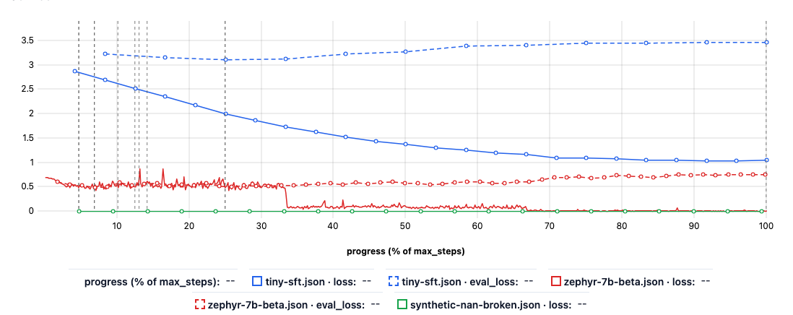
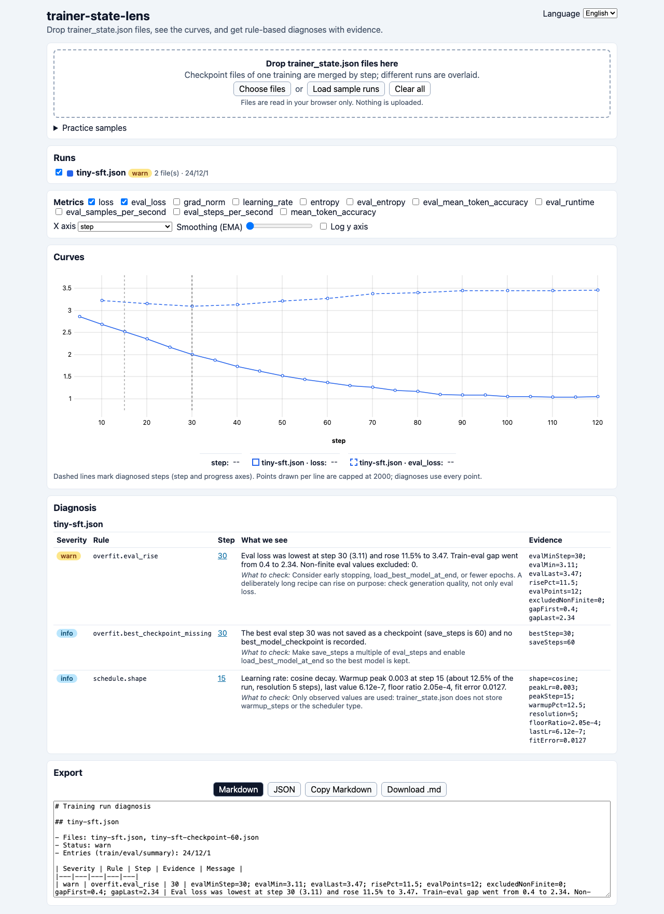
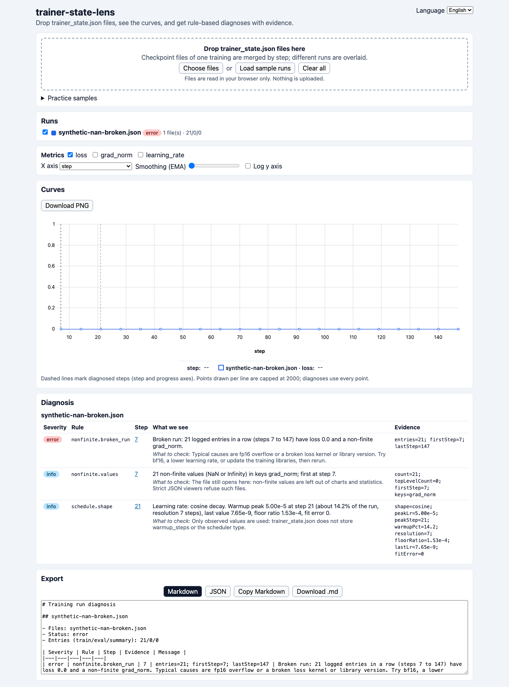
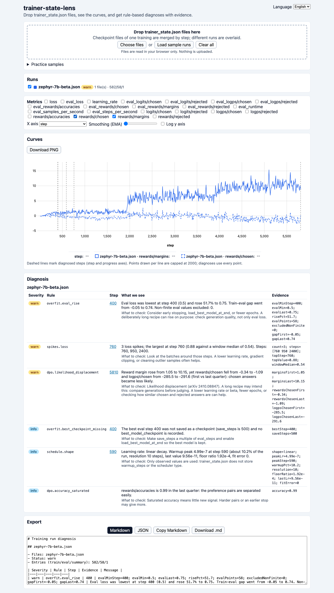
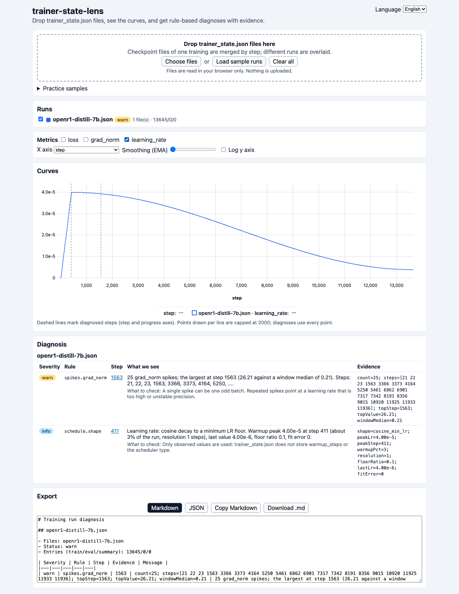
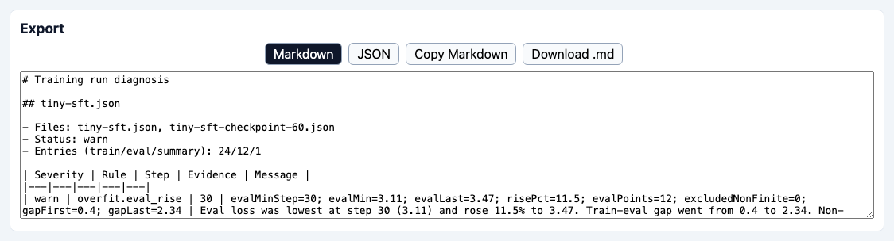
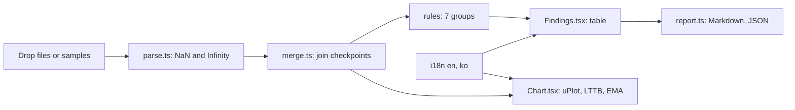

# trainer-state-lens

**English** | [한국어](README.ko.md)

Drop one or more Hugging Face `trainer_state.json` files into your browser and get overlaid training curves plus rule-based diagnoses with evidence: overfit onset, NaN or broken runs, loss and grad_norm spikes, divergence, learning-rate schedule shape, DPO likelihood displacement and GRPO stall. It works after the training is over, needs no logging set up beforehand, and the files never leave your browser.


*The chart after pressing **Load sample runs**: four practice files are loaded, the two `tiny-sft` files merge into one run, so three runs are drawn. Their lengths differ by more than 10x, so the x axis opens as progress (% of `max_steps`). The diagnosis tables sit below the chart (see the scenarios).*

## Who it is for

- You trained with `Trainer` or TRL (SFT, DPO, GRPO) and kept no W&B or TensorBoard log, only `trainer_state.json`.
- You downloaded a checkpoint from the Hub and want to see how its training went.
- You want a paste-ready Markdown summary of a run for a pull request or a model card.

## Install

You need Node.js `^22.12.0`, `^24.0.0` or `>=26.0.0` (the test runner vitest 5.1.0 requires it; Node 20 does not run `npm test`) and git.

```bash
# Node via nvm (https://github.com/nvm-sh/nvm; any Node manager works), then the app
nvm install 24
git clone https://github.com/LeeGyeongPil/trainer-state-lens.git
cd trainer-state-lens
npm install
```

On a minimal Linux image install `git`, `curl` and `ca-certificates` first (for example `apt-get install -y git curl ca-certificates`). The app itself is static files: `npm run build` produces `dist/`, which any static host can serve. The repository ships a GitHub Pages workflow (`.github/workflows/pages.yml`); it is off by default. To deploy on every push to `main`, enable Pages with the "GitHub Actions" source in the repository settings and add the Actions repository variable `PAGES_ENABLED=true`; you can also start it by hand from the Actions tab.

## Quick start

```bash
npm run dev
```

Open the printed address (by default `http://localhost:5173`), open **Practice samples**, and press **Load sample runs**. No key, GPU or network is needed.

Or drop your own file: a `trainer_state.json` lives in the output folder of a run and in every `checkpoint-*` folder.

## Using it

| Control | What it does |
|---|---|
| Drop zone / **Choose files** | Reads files in the browser. Checkpoint files of one training are merged by step; different runs are overlaid. |
| **Load sample runs**, **Practice samples** list | Adds bundled practice files (see below). |
| Run list | Colour, name, status and file count per run; the checkbox hides a run in the chart. |
| Metrics checkboxes | Only keys the loaded files contain are offered (`loss`, `eval_loss`, `grad_norm`, `learning_rate`, `rewards/margins`, ...). |
| X axis | `step`, `epoch`, `tokens` when the files have `num_tokens`, or `progress` (step as % of `max_steps`). When the shown runs differ in length by more than 10x it opens as `progress`; your own choice from the menu wins. |
| Scales | A metric whose largest value is above 0 but below 0.01 (for example `learning_rate`) goes on a second y axis on the right, in exponent notation (for example `4.0e-5`), only when a larger-valued metric such as `loss` is shown too. Both axes then carry the metric name (`left axis: loss`, `right axis: learning_rate`). A metric that is all zeros never opens the right axis. The axis width fits the longest tick label. |
| Smoothing (EMA) | Exponential moving average slider; diagnoses always use the raw values. |
| Log y axis | Logarithmic scale. |
| Diagnosis table | Severity, rule, step, evidence numbers, what we see, what to check. The step link zooms the chart to that step; dashed lines mark diagnosed steps on the step axis. |
| Export | Markdown or JSON, copy or download. |
| Language | English or 한국어 menu in the top right. |

The chart draws at most 2000 points per line (LTTB downsampling); the rules read every point. Comparing runs shows a reminder: logged loss is not comparable across different gradient accumulation settings or library versions, so compare shapes, not absolute values.

### Scenario 1: is my SFT overfitting?

Open `tiny-sft` and `tiny-sft-checkpoint-60` (the checkpoint file and the final file of the same run). They are merged into one run of 37 entries.


*Eval loss is lowest at step 30 and then rises 11.5%, the train-eval gap grows from 0.40 to 2.34. The best step was not saved as a checkpoint.*

The `warn` row says where the overfit starts and the `info` row warns that the best step was never saved (`save_steps` 60, best step 30). Suggested fixes: early stopping, `load_best_model_at_end`, and `save_steps` as a multiple of `eval_steps`.

### Scenario 2: a file that strict JSON viewers refuse

`trainer_state.json` files written after an fp16 overflow can contain bare `NaN`, which is not valid JSON. Load `synthetic-nan-broken`:


*The file opens. The `error` row reports 21 logged entries in a row with loss 0.0 and non-finite grad_norm (steps 7 to 147); an `info` row lists where the NaN values are.*

### Scenario 3: DPO where the reward margin grows but chosen answers get less likely

Open `zephyr-7b-beta`, then switch the metrics to `rewards/margins` and `rewards/chosen`.


*The margin grows while `rewards/chosen` falls: the rule reports likelihood displacement (arXiv 2410.08847) with first and last quarter averages.*

### Scenario 4: is this learning-rate schedule normal?

Open `openr1-distill-7b` (13,645 points) and show `learning_rate`.


*A cosine decay that stops at 10% of the peak is recognised as `cosine_min_lr`, not reported as odd. The `spikes.grad_norm` finding is reported separately (25 spikes, largest at step 1563).*

### Scenario 5: paste the result somewhere


*The export panel shows the exact Markdown or JSON text that **Copy** puts on the clipboard.*

The Markdown has one table per run. An excerpt (from the snapshot test `tests/__snapshots__/report.test.ts.snap`):

```markdown
## tiny-sft.json

- Files: tiny-sft-checkpoint-60.json, tiny-sft.json
- Status: warn
- Entries (train/eval/summary): 24/12/1

| Severity | Rule | Step | Evidence | Message |
|---|---|---|---|---|
| warn | overfit.eval_rise | 30 | evalMinStep=30; evalMin=3.11; evalLast=3.47; risePct=11.5; ... | Eval loss was lowest at step 30 (3.11) and rose 11.5% to 3.47. ... |
```

JSON uses a fixed schema: `{ version, lang, runs: [{ name, status, files, entries: { train, eval, summary }, findings: [{ rule, severity, step, evidence, message }] }] }`. The same input always gives the same output.

## Reading the findings

Each run gets its own diagnosis table. Read it like this:

- **Severity**: `error` means the run is probably broken, `warn` means "go and look", `info` is a fact worth knowing, `ok` means the rule looked and found nothing. A `warn` is not a failure: a long recipe may do it on purpose (zephyr-7b-beta in scenario 3 raises a `warn` for likelihood displacement, so compare generations before judging). The badge of the run is its worst finding.
- **Step**: a link. Clicking it zooms the chart to that step, and dashed vertical lines mark diagnosed steps on the `step` and `progress` axes.
- **Evidence**: the numbers the rule used (for example `evalMinStep=30; risePct=11.5`). The same numbers are in the Markdown and JSON export, so a finding can be checked by hand.
- **What we see / what to check**: a plain sentence about the pattern and a suggested next look. Rules only describe the log; they cannot know your intent.

## What it checks

Rules switch on only when the file has the needed keys (files from 2023 have no `grad_norm`, for example). Severities are explained above.

| Rule | Needs | Reports | Default threshold |
|---|---|---|---|
| `nonfinite.broken_run` | `loss`, `grad_norm` | `error` when loss is 0.0 with non-finite grad_norm in a row | 3 or more entries in a row |
| `nonfinite.all_loss` | `loss` | `error` when every logged train loss is NaN / Infinity (broken from the first entry) | all entries |
| `nonfinite.values` | any | `warn` with keys and first step of NaN / Infinity values inside `log_history`; `info` when the only ones are top-level (for example `best_metric`) or the run already has a `broken_run` / `all_loss` error | any |
| `run.empty` | any | `info` when the file has no train entries, so there is nothing to diagnose | n/a |
| `overfit.eval_rise` | `eval_loss` | `warn` when eval loss rises above its minimum (non-finite values excluded and counted), `ok` otherwise | rise of 5% or more |
| `overfit.best_checkpoint_missing` | `eval_loss`, `save_steps` | `info` when the best eval step has no saved checkpoint | n/a |
| `spikes.loss`, `spikes.grad_norm` | `loss`, `grad_norm` | `warn` for isolated jumps (rolling median plus MAD with relative and absolute floors) | window 20 points, 6 MADs, 50% above median, 15% of the starting level |
| `spikes.divergence` | `loss` | `error` when loss ends non-finite or climbs back far above its best level | 2x the best level and 25% of the starting level |
| `schedule.shape` | `learning_rate` | `info` with shape (constant, linear, cosine, with or without minimum-LR floor), warmup peak and fit error; `warn` for an irregular shape | fit error above 0.08 |
| `run.incomplete` | `max_steps` | `info` when `global_step` is below `max_steps` | n/a |
| `dpo.likelihood_displacement` | `rewards/margins`, `rewards/chosen`, `logps/chosen` | `warn` when the margin grows while chosen rewards and log-probabilities fall | first vs last quarter means |
| `dpo.accuracy_saturated` | `rewards/accuracies` | `info` when accuracy is saturated | 0.95 |
| `grpo.zero_std_groups`, `grpo.reward_flat`, `grpo.kl_high`, `grpo.entropy_collapse`, `grpo.truncation` | GRPO keys | `warn` or `info` for groups with identical rewards, flat reward, large KL, collapsing entropy, completions hitting the length limit | zero-std share 0.5, reward gain 0.02, KL 0.1 |

Every threshold is a field of `DEFAULT_THRESHOLDS` in `src/core/rules/options.ts`; `diagnose(run, { thresholds })` overrides them per call. There is no settings screen yet (see Roadmap).

Only observed values are used: `trainer_state.json` does not store `warmup_steps` or the scheduler type, so the schedule rule describes the shape it sees.

## Practice samples

These are bundled, offline practice files: **real files and synthetic files, not live training**. Each carries a source label in the app.

| Label | Files | Shows |
|---|---|---|
| own run (MIT) | `tiny-sft`, `tiny-sft-checkpoint-60`, `tiny-dpo`, `tiny-grpo` | tiny 2-layer GPT-2 models trained on CPU; the SFT one memorises 16 sentences on purpose |
| Hub file | `zephyr-7b-beta` (MIT), `mistral-7b-sft-beta` (MIT), `smollm2-1.7b-instruct` (Apache-2.0), `openr1-distill-7b` (Apache-2.0) | real runs: likelihood displacement, a run stopped at 272 of 406 steps, a healthy DPO reference, a minimum-LR floor |
| synthetic | `synthetic-nan-broken`, `-eval-nan`, `-infinity-best`, `-flat-jitter`, `-diverge`, `-grpo-stall` | failure shapes seen in public files; written by `tools/make-samples/make_synthetic.py` |

Sources and licenses of every file: [samples/SOURCES.md](samples/SOURCES.md). The real mode is your own files; regenerating the own-run samples is optional (see `tools/make-samples/README.md`; installing torch, transformers and trl takes a while and the speed depends on your CPU).

## Pitfalls it handles

- Bare `NaN`, `Infinity`, `-Infinity` outside strings (even in the top-level `best_metric`) are restored; a `"NaN"` inside a string stays text.
- A NaN in `eval_loss` does not become the "minimum"; non-finite values are excluded and counted.
- `loss 0.0` together with `grad_norm NaN` is a broken run, not a converged one.
- A converged loss with tiny jitter is not reported as spikes (relative and absolute floors).
- A cosine schedule that stops at a floor is not reported as an odd shape.
- An unfinished run (a checkpoint copy) is labelled instead of read as complete.
- The best eval step may not exist as a checkpoint; this is reported.
- Logged loss differs with gradient accumulation and library versions ([Hugging Face blog](https://huggingface.co/blog/gradient_accumulation), [transformers#40564](https://github.com/huggingface/transformers/issues/40564)); runs are compared by shape, and rules only use relative changes inside one run.

## Language

The screen, the diagnosis texts and the exported Markdown are available in English and 한국어. Pick one in the **Language** menu; the choice is saved in `localStorage` (key `trainer-state-lens.lang`). Only on the first visit is the browser language used (`ko*` gives Korean, anything else English). `?lang=ko` or `?lang=en` in the address wins for that visit and is not saved.

## Privacy

The app reads files with the browser's `File` API and has no server. A test checks that `src/` contains no `fetch`, `XMLHttpRequest`, `WebSocket`, `sendBeacon` or `EventSource`, so nothing is uploaded.

## How it works



1. The parser scans the text once, turns non-finite tokens outside strings into markers and restores them as numbers, then splits `log_history` into train, eval and summary entries.
2. The merger treats files with equal settings and equal shared steps as one run and keeps the longest record; other files become separate runs.
3. The rule engine in `src/core` is plain TypeScript without DOM or React, so a command-line tool can reuse it later.
4. The chart (uPlot on a canvas) and the diagnosis table read the same merged runs.
5. The exporter writes Markdown or JSON from the diagnoses in the chosen language.

## When to use it

It is meant for files you already have after a run. It does not collect logs during training and does not replace a tracker.

| Situation | Use |
|---|---|
| You have finished `trainer_state.json` files and want curves plus a first diagnosis, offline | this app |
| You want to log and compare runs while they train | an experiment tracker such as [Trackio](https://github.com/gradio-app/trackio), [Weights & Biases](https://github.com/wandb/wandb), [TensorBoard](https://github.com/tensorflow/tensorboard) or [MLflow](https://github.com/mlflow/mlflow) |
| You train with LLaMA-Factory and want its own loss plot | the plot script of [LLaMA-Factory](https://github.com/hiyouga/LLaMA-Factory) |

Check each project's own documentation for what it supports today.

## Troubleshooting

| Symptom | Cause | Fix |
|---|---|---|
| `npm test` fails right away on Node 20 | vitest 5.1.0 needs Node `^22.12.0`, `^24.0.0` or `>=26.0.0` | switch Node (`nvm install 24`) and run `npm install` again |
| "Could not read <file>" card | the file is not a trainer state (cut-off or wrong JSON) | check that it is a whole `trainer_state.json`; other files keep working |
| A metric is missing from the checkboxes | the file has no such key | only keys in `log_history` are offered |
| "Copy failed" | the browser blocks clipboard access | select the text in the export box and copy by hand, or use **Download** |
| The page is blank when opened from `dist/index.html` by double click | browsers block module scripts on `file://` | build and serve it: `npm run build && npm run preview` |

## Development

```bash
npm install
npm test            # vitest, 13 files, 107 tests
npm run typecheck   # tsc, including tests
npm run build       # tsc -b && vite build, output in dist/
npm run lint        # oxlint
```

Bugs and ideas are welcome as issues. Changes are listed in [CHANGELOG.md](CHANGELOG.md).

## Roadmap

- M2: `npx trainer-state-lens diagnose <files> --format md|json --lang en|ko --fail-on warn|error`, so CI can fail on a bad run (reuses `src/core`).
- M3: import `trainer_log.jsonl` (LLaMA-Factory) and other log formats, compare against the schedule you expected (warmup, scheduler), a threshold settings screen.

Not planned: live collection during training, accounts, uploads, reading `training_args.bin`.

## License and sources

MIT, see [LICENSE](LICENSE). Bundled Hub files keep their own licenses (MIT, Apache-2.0), listed in [samples/SOURCES.md](samples/SOURCES.md).

Sources (checked 2026-11-13):

- `TrainerState` fields: https://huggingface.co/docs/transformers/en/main_classes/callback
- TRL DPO and GRPO metrics: https://huggingface.co/docs/trl/en/dpo_trainer, https://huggingface.co/docs/trl/en/grpo_trainer
- Likelihood displacement: https://arxiv.org/abs/2410.08847
- Gradient accumulation and logged loss: https://huggingface.co/blog/gradient_accumulation, https://github.com/huggingface/transformers/issues/40564
- Chart library: https://github.com/leeoniya/uPlot
